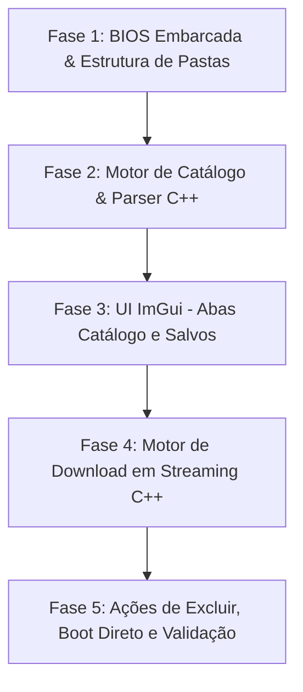

# Planejamento do Projeto XBSX2 Custom (Catálogo, Download e BIOS Embarcada) (AI-assisted)

## 1. Visão Geral e Objetivo

O objetivo deste projeto é criar uma versão customizada do **XBSX2** (front-end do emulador PCSX2 adaptado para UWP / Xbox Series X/S e Xbox One), integrando a experiência de catálogo e download de jogos desenvolvida no **ARMSX2-forkv2**, com:
- **Zero configuração:** BIOS de PlayStation 2 embutida diretamente no pacote, configurada automaticamente no primeiro boot.
- **Formatos Suportados na V1 (Sem Descompactação):** Suporte exclusivo para arquivos **`.chd`** (preferencial/comprimido sem perda que roda direto no PCSX2) e **`.iso`**. Arquivos compactados (`.7z`, `.zip`, `.rar`) são **estritamente excluídos** do catálogo e do fluxo de download nesta primeira versão, eliminando etapas de extração, tempo de espera pós-download e uso de espaço dobrado no armazenamento do Xbox.
- **Navegação em 2 Abas:**
  - **Catálogo:** Exibição exclusiva de jogos de PS2 disponíveis em formatos **`.iso`** e **`.chd`** (qualquer título em formato compactado ou incompatível é ocultado e não é listado), com capas oficiais e opção de baixar diretamente pelo console.
  - **Salvos:** Jogos locais baixados e prontos para jogar imediatamente com um clique no botão (A), e opção de exclusão (Delete) para gerenciar o armazenamento interno/USB.
- **Escopo Enxuto e Foco em Console:** Não portar o ecossistema complexo mobile do ARMSX2 (telas de toque, botões virtuais, layouts móveis). Manter toda a base gráfica, desempenho e navegação por controle nativa do XBSX2 (Dear ImGui Fullscreen UI em DirectX 11/12).

---

## 2. Comparativo Arquitetural: ARMSX2 vs. XBSX2

| Componente | ARMSX2-forkv2 (Mobile/Android) | XBSX2 Custom (Xbox / UWP) |
| :--- | :--- | :--- |
| **Linguagem / UI** | Kotlin + Jetpack Compose / XML | **C++20 / C++WinRT + Dear ImGui Fullscreen UI** |
| **Navegação** | Touchscreen + Drawer / BottomBar | **Controle Xbox** (LB / RB para abas, D-Pad/Analógico no grid, botão A para ação, Y para buscar, Menu/Start para opções) |
| **BIOS** | Asset extraído em Java para a pasta de dados | **Binário no pacote UWP (`Assets/bios/`)**, copiado no boot para `EmuFolders::Bios` |
| **Manifesto de ROMs** | `catalog_manifest_ps2.txt` (14.400+ linhas) | Arquivo de texto nos recursos do pacote, carregado e indexado em **C++** |
| **Download de Arquivos**| `RomDownloadManager.java` (HttpURLConnection) | **Motor de download C++ em streaming** (`WinHTTP` ou `Windows::Web::Http::HttpClient`) gravando em chunks direto no disco |
| **Armazenamento** | `/sdcard/Android/data/...` | Sandbox UWP (`EmuFolders::DataRoot/roms` ou drive USB) |

---

## 3. Especificação dos Módulos

### Módulo 1: BIOS Embarcada (Auto-Deploy)
* **Arquivo:** `SCPH-90001_BIOS_V18_USA_230.bin` (~4 MiB) embutido no pacote do aplicativo (`pcsx2-uwp/Assets/bios/`).
* **Fluxo de Inicialização:**
  1. Durante a inicialização no `WinRTHost::InitializeConfig()`, após montar `EmuFolders::SetDataDirectory()`, verificar se `EmuFolders::Bios` contém uma BIOS válida.
  2. Se o diretório estiver vazio ou se nenhuma BIOS estiver definida em `PCSX2.ini`:
     - Copiar o arquivo da pasta de recursos do pacote (`EmuFolders::Resources/bios/`) para a pasta de dados de usuário (`EmuFolders::Bios/`).
     - Definir `BaseFilenames.Bios = "SCPH-90001_BIOS_V18_USA_230.bin"` na configuração ativa.
  3. Invocar atualização interna das pastas do emulador (`VMManager::Internal::UpdateEmuFolders()`).
* **Resultado:** O usuário instala o app e joga imediatamente sem nunca ver tela de erro de BIOS ausente.

---

### Módulo 2: Motor de Catálogo em C++ (`CatalogManager`)
* **Base de Dados Híbrida (Offline + Atualização em Nuvem):**
  - Utiliza o manifesto embutido no pacote (`catalog_manifest_ps2.txt`) como base primária offline.
  - Em segundo plano (de forma assíncrona e silenciosa), o app consulta se há uma versão mais nova do manifesto no servidor/GitHub; se encontrada, atualiza o cache local em `EmuFolders::DataRoot` sem travar a navegação.
* **Filtro de Formatos (V1):**
  - O catálogo processará apenas entradas cujo arquivo ou fonte de download seja **`.chd`** ou **`.iso`**.
  - Entradas que existam apenas em arquivos compactados (`.7z`, `.zip`, `.rar`) são desconsideradas nesta versão inicial.
* **Agrupamento Inteligente de Variantes (Regiões e Discos):**
  - Jogos com múltiplas regiões (USA, Europe, Japan) ou múltiplos discos (Disc 1, Disc 2) são **agrupados em um único card** na grade visual por `groupKey`.
  - Prioridade de exibição padrão: versão USA ou PT-BR.
  - Ao clicar no card de um jogo com variantes, um popup rápido permite escolher qual região ou disco baixar.
* **Busca Inteligente com Normalização:**
  - O algoritmo de busca remove acentuações, caracteres especiais, dois pontos e pontuações de ponta a ponta (ex.: pesquisar `dragon ball 3` localiza perfeitamente `Dragon Ball Z - Budokai Tenkaichi 3`).
* **Estrutura dos Dados (`CatalogEntry`):**
  - `fileName`: nome do arquivo (ex.: `God of War (USA).chd`).
  - `title`: título normalizado para exibição (ex.: `God of War`).
  - `coverUrl`: URL da capa oficial (repositórios curados IGDB / Libretro).
  - `downloadUrl`: URL direta primária (quando presente).
  - `isDownloaded`: booleano indicando presença local.
  - `localPath`: caminho absoluto no armazenamento local.
* **Performance:**
  - Carregamento assíncrono em thread secundária para não retardar a inicialização.
  - Tabela hash / mapa para busca por nome de arquivo em O(1).
  - Índice de busca textual pré-normalizado em minúsculas para filtro instantâneo por controle.

---

### Módulo 3: Interface com 2 Abas no ImGui Fullscreen UI
Local de implementação principal: `pcsx2/ImGui/FullscreenUI.cpp` e `FullscreenUI_Internal.h`.

1. **Comportamento Inteligente de Inicialização (Startup View):**
   - Ao inicializar o emulador, verificar a quantidade de jogos salvos localmente:
     - Se houver 1 ou mais jogos baixados: o app abre diretamente na aba **"Salvos"** para acesso rápido aos jogos prontos.
     - Se a lista estiver vazia (ex.: primeira execução após instalação): o app abre automaticamente na aba **"Catálogo"** para o usuário escolher o primeiro título.
2. **Barra de Navegação Superior:**
   - Seletor de abas: `[ Catálogo ]` e `[ Salvos ]`.
   - Atalhos de controle do console: **LB** (Aba anterior) e **RB** (Próxima aba).
   - Indicador discreto no topo exibindo progresso de download ativo caso o usuário esteja em outra tela.
3. **Aba "Catálogo":**
   - Grid contendo exclusivamente títulos disponíveis em `.iso` ou `.chd`.
   - **Cache Permanente de Capas (Lazy Loading):** As capas são baixadas assincronamente sob demanda (apenas as que entram na área visível da tela) e salvas em `EmuFolders::DataRoot/covers`. Após o primeiro download, a imagem é lida instantaneamente do disco local sem requisições de rede.
   - Indicador visual no card:
     - Ícone de nuvem/download quando ainda não baixado.
     - Ícone de checkmark/play quando já disponível localmente.
     - Barra de progresso com porcentagem e taxa (MB/s) no card do jogo que estiver baixando.
   - Ao selecionar e pressionar **(A)**:
     - Se o jogo possuir múltiplas versões/discos: exibe menu de seleção da variante desejada.
     - Diálogo de confirmação: *"Baixar [Nome do Jogo]?"* e enfileira o download.
     - Se já baixado: inicia a emulação diretamente.
   - Pressionar **(Y)** aciona a busca textual integrada ao teclado virtual do Xbox (`UWPKeyboard`).
4. **Navegação Livre Durante o Download:**
   - O usuário não fica preso a nenhuma tela bloqueante; pode navegar livremente pelo Catálogo, pela aba Salvos e pelas configurações enquanto o arquivo é baixado em segundo plano.
5. **Aba "Salvos":**
   - Grid contendo apenas os jogos baixados e salvos no armazenamento local (`EmuFolders::DataRoot/roms` ou drive USB configurado).
   - Pressionar **(A)**: inicia o jogo no emulador (`VMManager::DoStartPath`).
   - Pressionar **(Menu / Start)**: abre menu de opções contextuais:
     - *Jogar (Fast Boot / Full Boot)*
     - *Configurações do Jogo (Game Properties)*
     - **Excluir do Console** (ação destacada para limpeza de disco).
6. **Funcionalidade de Exclusão com Preservação de Progresso:**
   - Diálogo de confirmação: *"Tem certeza que deseja apagar a ROM de [Nome do Jogo] do armazenamento para liberar espaço? Seus dados salvos (Memory Card e Save States) serão preservados."*
   - Ao confirmar: remove **estritamente o arquivo da imagem (.chd/.iso)** via `FileSystem::DeleteFile`. Os saves no Memory Card e Save States ficam 100% preservados para caso o usuário jogue novamente no futuro.
   - Atualiza a aba "Salvos" e sincroniza o status na aba "Catálogo".

---

### Módulo 4: Gerenciador de Download em Streaming (`RomDownloader`)
No ambiente Xbox UWP, a memória RAM atribuída ao app container possui cotas rígidas. Arquivos de 1 a 4 GB devem ser gravados em disco por fluxo contínuo (streaming).

* **Destino do Armazenamento (Interno vs. USB):**
  - Destino padrão: `EmuFolders::DataRoot/roms` (armazenamento interno do app).
  - Opção em configurações para selecionar uma pasta em **drive USB / HD Externo**, permitindo salvar jogos diretamente em armazenamento removível.
* **Checagem Prévia de Espaço em Disco (Pre-allocation Check):**
  - Antes de iniciar a gravação, obter o tamanho real do arquivo (`Content-Length`) e verificar o espaço livre na partição de destino via `GetDiskFreeSpaceExW`.
  - Se o espaço livre for insuficiente (tamanho do arquivo + 200 MB de margem de segurança), o download é **bloqueado previamente** com mensagem clara ao usuário: *"Espaço insuficiente no armazenamento. O jogo necessita de X.X GB, mas há apenas Y.Y GB disponíveis. Exclua outros jogos na aba Salvos para liberar espaço."*
* **Política de Concorrência e Performance:**
  - **1 download por vez:** Fila estritamente serial para evitar gargalo de banda e I/O de disco.
  - **Pausa automática na emulação:** Ao iniciar qualquer jogo, o download em andamento é pausado (ou novos downloads são bloqueados) para assegurar 100% de CPU, GPU e estabilidade de 60 FPS no emulador.
* **Pipeline de Streaming Direto (Sem Extração):**
  - Uso de `WinHTTP` ou `Windows::Web::Http::HttpClient`.
  - Leitura em blocos contínuos de **64 KB a 512 KB** gravados diretamente no arquivo em disco via `FILE*` ou `HANDLE` Win32.
  - Gravação inicial com extensão temporária `.part` (ex.: `Gran Turismo 3.chd.part`). Ao atingir 100%, renomeia atomicamente para `.chd` ou `.iso`.
  - **Pronto para Jogar:** Como o arquivo já é uma imagem de disco pronta (`.chd` ou `.iso`), o jogo fica disponível instantaneamente na aba "Salvos" sem nenhuma etapa de descompactação.
* **Cascata de Resolução de Fontes (Filtro Rígido .CHD / .ISO):**
  - São aceitas **exclusivamente** fontes que entreguem `.chd` ou `.iso`. Links para `.7z`, `.zip` ou `.rar` são ignorados/descartados na resolução.
  - Prioridade de fontes:
    1. Espelhos de alta velocidade no Hugging Face (`/ps2chd/` com imagens `.chd` diretas).
    2. Endpoints de resolução da API (`by_alias` / `download_sources`) filtrando por extensões `.chd` e `.iso`.
    3. Coleções do Internet Archive (`archive.org/download/...`) com arquivos `.chd` ou `.iso`.
* **Resiliência de Rede e Suspensão do Console (Retomada Automática):**
  - Se a conexão oscilar ou cair durante o download de arquivos volumosos (2 a 4 GB), o downloader executa até **3 tentativas automáticas de reconexão**.
  - **Tolerância a Suspensão/Fechamento:** Ao suspender o console ou fechar o app, o buffer pendente é descarregado (`fflush`) e o arquivo `.part` permanece preservado no disco. Ao reabrir o app, o download é retomado exatamente de onde parou utilizando o cabeçalho `Range: bytes=OFFSET-`, sem descartar os gigabytes já baixados.

---

### Módulo 5: Preservação de Recursos Originais do XBSX2
Todos os recursos originais do XBSX2 serão integralmente preservados:
- Renderização nativa Direct3D 11 / Direct3D 12.
- Resolução interna até 4K com opções de aspect ratio (16:9, widescreen patches).
- Suporte a áudio XAudio2 com baixa latência.
- Mapeamento nativo para controles Xbox (XInput / WinRT Gaming Input).
- Suporte a Conquistas RetroAchievements.

---

## 4. Fases de Execução (Roadmap)

1. **Fase 1: BIOS Embarcada e Estrutura de Pastas** [Concluída]
   - [x] Integrar o arquivo da BIOS no projeto `pcsx2-uwp` e nos recursos do pacote.
   - [x] Criar rotina de auto-cópia e configuração no `WinRTHost::InitializeConfig()`.
   - [x] Garantir criação da pasta de ROMs padrão no `EmuFolders::DataRoot` e integração nas configurações de pastas.

2. **Fase 2: Motor de Catálogo & Parser C++** [Concluída]
   - [x] Criar classes `CatalogEntry`, `CatalogGroup`, `CatalogParser` e `CatalogManager` em C++.
   - [x] Incorporar `catalog_manifest_ps2.txt` filtrando estritamente para formatos `.chd` e `.iso` (14.277 títulos limpos, zero arquivos compactados).
   - [x] Implementar indexação em background, agrupamento de variantes, busca textual normalizada e checagem de arquivos locais.

3. **Fase 3: UI ImGui — Abas Catálogo e Salvos** [Concluída]
   - [x] Adaptar `FullscreenUI.cpp` para alternar entre as abas via **LB** / **RB** (e Q / E no teclado).
   - [x] Implementar grid do Catálogo e grid dos Salvos com design de cards responsivos de 5 colunas.
   - [x] Implementar busca textual normalizada instantânea compatível com o controle e teclado virtual Xbox UWP (botão Y).
   - [x] Implementar diálogo de variantes com ordenação regional (PT-BR > USA > outros).
   - [x] Implementar menu de contexto com Fast Boot, Full Boot, Configurações e exclusão com preservação de saves.

4. **Fase 4: Motor de Download em Streaming (Sem Extração)** [Concluída]
   - [x] Implementar `RomDownloader` com streaming direto para arquivo em disco (.part -> .chd/.iso).
   - [x] Integrar cascata de resolução de fontes aceitando apenas `.chd` e `.iso` (Hugging Face / Archive / APIs).
   - [x] Renderizar barra de progresso no card do jogo e diálogo de cancelamento/pausa.
   - [x] Implementar pré-alocação e checagem de espaço em disco (GetDiskFreeSpaceExW + 200MB margem).
   - [x] Implementar pausa automática ao iniciar emulação (VMManager hook).

5. **Fase 5: Ações de Excluir, Boot Direto e Validação** [Concluída]
   - [x] Adicionar ação de exclusão física com confirmação no menu de contexto preservando Memory Card e Save States.
   - [x] Integrar o clique em jogos salvos com `VMManager::DoStartPath` e opções de Fast/Full Boot.
   - [x] Realizar validação de ciclo completo (Catálogo -> Download -> Salvos -> Jogar -> Excluir).
